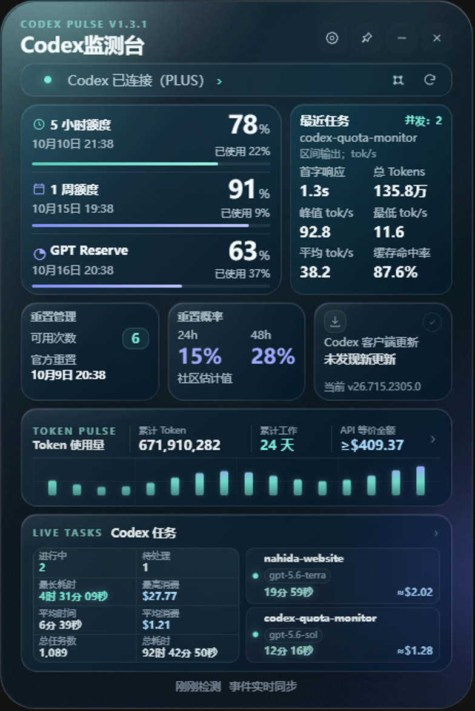
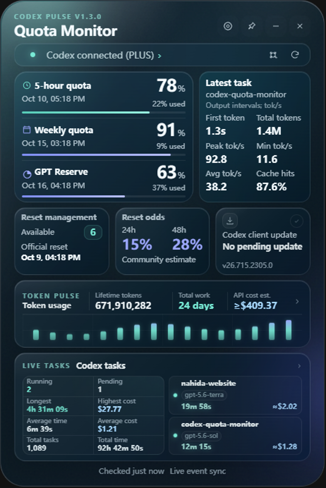

# Codex Quota Monitor / Codex 监测台

[](https://github.com/Nahida728/codex-quota-monitor/releases/latest)
[](https://github.com/Nahida728/codex-quota-monitor/releases/latest)
[](LICENSE)

**额度还剩多少，任务花了多少，一眼看清。**

一款轻量的 Windows 桌面监测工具，把 Codex 额度、Token 用量、任务进度和 API 等价消费放在同一张悬浮卡片上。支持中文和英文、系统托盘、自定义背景，以及可以随手移动的悬浮球。

[下载正式版](https://github.com/Nahida728/codex-quota-monitor/releases/latest) | [更新日志](CHANGELOG.md) | [反馈问题](https://github.com/Nahida728/codex-quota-monitor/issues) | [English](#english)

> 非官方社区项目，与 OpenAI 没有隶属、合作或背书关系。Codex、OpenAI 及相关图标归各自权利人所有。



## 主要功能

| 关注内容 | 监测台提供的信息 |
| --- | --- |
| 三种额度 | 5 小时、每周、独立 GPT Reserve 的剩余比例与恢复时间 |
| 重置 | 可用重置次数、每次到期时间、收到和使用记录、社区公开重置公告 |
| 本轮预测 | 周额度条标记用尽本轮 5 小时额度后的预计余额，附采样依据 |
| 重置日历 | 公告、收到和消耗记录按天显示，支持历史年份与格子详情 |
| 重置概率 | 优先展示 Tibo 承诺信号与目标倒计时，附历史 24 / 48 小时估计、区间和来源 |
| 用量与消费 | 官方累计 Token、工作天数、日 / 周 / 月趋势、本地模型明细与 API 等价消费 |
| 最近任务 | 首字响应、实时总 Tokens、峰值 / 最低 / 平均输出速率、缓存命中率 |
| 并行任务 | 大目标、子智能体、多模型参与、耗时与本轮消费，支持筛选和排序 |
| 更新 | Codex 客户端更新状态；监测台自身从 GitHub 检查、下载和安装更新 |

## 下载与开始使用

1. 从 [Releases](https://github.com/Nahida728/codex-quota-monitor/releases/latest) 下载 Windows x64 版本。
2. **安装版**使用 `setup-x64.exe`，提供安装、快捷方式及卸载；**便携版**使用 `portable-x64.exe`，直接运行。
3. 在这台电脑上安装官方 Codex Windows 客户端，并使用 ChatGPT 账户登录。监测台通过本地 app-server 读取额度，不需要填写 API Key。
4. 设置中可以切换语言、上传背景、调整透明度和启用顶部吸附。卡片可以拖动、锁定、置顶、收进托盘或折叠为悬浮球。

Windows x64；需要能够连接 OpenAI 服务的网络。API Key 登录通常不提供订阅额度。官方未返回 Reserve 独立桶时，界面会显示“未返回”。

## 版本更新

1.3.50 重构重置概率看板，优先显示检查站的 Tibo 承诺概率与明确目标倒计时；修复周额度小样本预测误报 0% 和客户端更新历史漏记。客户端记录按月份、日期整理，并缓存不变的日志和界面。

1.3.41 修复周额度预测因恢复时间戳微小波动反复重采样的问题，并放大重置日历的格子与间距，支持在日历内部横向滚动。

1.3.4 新增周额度预测刻线，以及官方公告、收到和消耗重置次数的全年日历。格子按天汇总，可切换历史年份并查看原始详情；预测依据同一轮 5 小时窗口内的额度消耗比例。

1.3.3 是紧急补丁，修复大账本在升级重启后被跳过、API 等价金额下降及旧会话回放造成任务耗时暴增的问题，支持从有效归档恢复原有统计。建议升级；错误来源和修复详情见更新日志。

1.3.2 修复公开重置公告被误过滤、手动刷新复用旧缓存的问题。公告与概率独立同步，自动检查最长约一分钟。

1.3.1 是紧急补丁，修复任务漏报和看板停留在已完成回合的问题，并在看板右上角加入运行并发数和子智能体提示。建议 1.3.0 用户升级；错误来源和修复详情见更新日志。

- 三额度和最近任务左右排列；重置管理、概率和客户端状态各有独立入口。
- 最近任务在执行过程中同步用量和缓存命中率，支持多个模型参与。
- 大目标和子智能体有明确标记。目标累计 Tokens、累计耗时与本轮模型消费分别展示。
- 正常完成、手动中断和异常结束分开处理。目标阶段或子智能体的受控停止不会作为异常提醒；已完成任务可以一键确认。
- 修复升级后模型用量减少的问题。归档会话继续计入，已有记录保留；API 消费详情提供“全量扫描全部会话”，用于主动重新核对历史数据。
- 支持 GPT-6.1 Sol 的标准 API 等价计价；Reserve 从独立官方额度读取。
- 新增自动更新，改进交互反馈、长文本换行和中英文文案。

[查看今天的完整更新记录](CHANGELOG.md#130--2026-10-10)

## 怎样理解这些数字

**累计 Token**来自官方账户使用统计。**模型和任务明细**来自这台电脑的 Codex 日志，覆盖普通及归档会话；不涵盖其他设备或未落盘的调用。模型明细可能按官方每日用量校正，因此不能直接当作官方逐模型账单。

**API 等价消费**按公开标准 API 价格估算，不是订阅账单，也不表示实际扣款。缓存输入已经包含在输入 Token 中，不应再次相加。历史记录缺少完整定价信息时，保留 Token 并标注金额待重算。

**缓存命中率**为已观测调用的缓存输入 / 输入 Tokens，多个模型按输入量加权，不包含输出。**峰值和最低速率**是日志记录之间的输出区间速率；平均速率包含整个回合的等待和工具时间。官方未记录首字响应时显示“—”。

**重置公告和概率**来自 [Codex Reset](https://codex-reset.com/) 和 [Codex Reset Tracker](https://codexresettracker.com/)。公告能在恢复联网后补看，但不证明本账户已经重置；概率是社区估计，不能保证未来重置。过期或样本不足的数据不显示概率。本机推断的非自然重置不再进入公告历史。

## 自动更新与本地数据

监测台启动后会自动检查本仓库，之后定期检查并下载新版本。下载就绪后，在已观测任务空闲时重启监测台，也可以在设置中点击“重启并更新”。安装版使用 Electron 更新器；便携版核对 GitHub 文件摘要后替换程序，并保留旧文件以便回退。

更新会重启监测台，**不会停止 Codex 或它的任务**。首个带自动更新功能的版本需要手动安装；正式版接收后续正式版本，测试版也可以接收后续测试版本。

设置、背景和统计记录保存在本机应用数据目录中。监测台不上传对话；界面不接触账户凭据、API Key 或原始对话内容。额度通信由本地 Codex app-server 处理；网络请求也用于公开检查站和 GitHub 更新。请保留 `quota-state.json.archive`，它用于恢复历史记录。

## 开发

```powershell
npm ci
npm start
npm test
npm run build -- --publish never
```

主要逻辑位于 `src/`。修改前请阅读 [AGENTS.md](AGENTS.md)。便携版和安装版打包内容使用明确白名单，开发文件不进入应用。

遇到问题时，请附版本、语言和复现步骤；日志中请移除账户或个人信息。欢迎通过 Issue 或 Pull Request 提出改进。觉得有用的话，可以给项目一个 Star，方便以后找到它。

---

## English

**See your remaining quota and task usage at a glance.**

Codex Quota Monitor is a compact Windows desktop companion for Codex. A floating card brings quota, token usage, task progress and API-equivalent costs together. It supports Chinese and English, the system tray, custom backgrounds and a movable floating orb.

[Download the stable release](https://github.com/Nahida728/codex-quota-monitor/releases/latest) | [Changelog](CHANGELOG.md#130--2026-10-10) | [Report an issue](https://github.com/Nahida728/codex-quota-monitor/issues)

> An independent community project. It is not affiliated with, partnered with or endorsed by OpenAI. Codex, OpenAI and their icons belong to their respective owners.



### Features

| Area | What you can see |
| --- | --- |
| Quota | Remaining 5-hour, weekly and independent GPT Reserve quota, with recovery times |
| Resets | Available credits, individual expiry dates, received/consumed history and public announcements |
| Quota projection | Weekly balance estimated after exhausting this 5-hour quota, with observed inputs |
| Reset calendar | Daily announcement and received/consumed credit grids, with year selection and day details |
| Reset estimates | Priority Tibo commitment signals and target countdowns, with historical 24 / 48-hour odds, ranges and sources |
| Usage and cost | Official lifetime tokens, recorded work days, daily/weekly/monthly trends and local model costs |
| Latest task | First-token latency, live total tokens, peak/minimum/average output rates and cache hit rate |
| Concurrent tasks | Goals, subagents, multiple models, elapsed time and current-turn costs, with filtering and sorting |
| Updates | Codex client update status and automatic GitHub updates for the monitor itself |

### Getting started

1. Download the Windows x64 build from [Releases](https://github.com/Nahida728/codex-quota-monitor/releases/latest).
2. Choose `setup-x64.exe` for installation, shortcuts and uninstall support, or run `portable-x64.exe` directly.
3. Install the official Codex Windows client and sign in with your ChatGPT account. The monitor reads quota through the local app-server; no API Key entry is required.
4. Use Settings to change language, upload a background and enable top-edge docking. Move, lock or pin the card, hide it in the tray, or collapse it to an orb.

Requires Windows x64 and network access to OpenAI. API-key mode usually does not supply subscription quota. GPT Reserve stays unavailable when its independent bucket is absent.

### Recent updates

1.3.50 rebuilds the reset forecast dashboard, prioritizing the checkpoint's Tibo commitment odds and explicit target countdowns. It fixes small samples falsely predicting 0% weekly quota and missing client update records, groups upgrades by month/date, and caches unchanged logs and UI.

1.3.41 fixes quota projection repeatedly restarting on small recovery-timestamp changes and enlarges reset-calendar cells and spacing, with internal horizontal scrolling.

1.3.4 adds a weekly-quota projection marker and yearly calendars for official announcements and received/consumed reset credits. Select a day or an older year to inspect retained details. The projection uses observed quota-consumption deltas within the same 5-hour window.

The 1.3.3 emergency patch restores large ledgers skipped after upgrade restarts and fixes inflated task durations from replayed sessions. Upgrading is recommended. Existing statistics can be recovered from valid archives; see the changelog for causes and fixes.

1.3.2 fixes discarded public reset confirmations and stale manual-refresh results. Announcements and odds update independently, with automatic checks up to roughly one minute apart.

The 1.3.1 emergency patch restores hidden live tasks, keeps the dashboard on running turns, and adds a concurrent-task count with subagent details. It is recommended for 1.3.0 users; the changelog documents the causes and fixes.

The quota panel now sits beside the live task dashboard. Reset management, reset estimates and client updates have separate entry points. Goals and subagents show their context and participating models; goal-wide tokens/time are kept separate from current-turn costs. Completed tasks can be confirmed together, and managed goal/subagent stops are distinguished from abnormal interruptions.

This release fixes model usage disappearing after an upgrade, retains recorded usage from archived sessions, adds an explicit full-history scan, supports GPT-6.1 Sol pricing, improves Reserve reads and introduces automatic monitor updates. Text, wrapping and interaction feedback have also been revised. See the [full changelog](CHANGELOG.md).

### Reading the metrics

Lifetime tokens come from the official account usage endpoint. Model/task details come from local normal and archived Codex sessions and do not include other devices or unlogged calls. Model totals may be calibrated against official daily usage; they are not an official per-model bill.

API-equivalent cost uses standard published API rates. It is an estimate, not a subscription charge. Input already includes cached input. Historical tokens remain visible when missing pricing information requires recalculation.

Cache hit rate is cached input divided by input over observed calls, weighted across models and excluding output. Peak/minimum rates average output between log records; the average includes whole-turn waits and tool time. Missing first-token latency is shown as “—”.

Public reset announcements and estimates come from [Codex Reset](https://codex-reset.com/) and [Codex Reset Tracker](https://codexresettracker.com/). They describe community observations and do not confirm a reset for your account. Stale or insufficient samples have no displayed probability. Locally inferred non-natural resets are no longer used as announcement history.

### Updates and privacy

The monitor checks this repository automatically and downloads available updates. When observed tasks are idle, it restarts to install; Settings also provides a manual restart/update action. Electron binaries require a monitor restart. Codex and its tasks keep running. Install this release manually to enable future automatic updates; stable builds follow stable releases, while beta builds may also receive prereleases.

Settings, backgrounds and usage records stay in local application data. The monitor does not upload conversations or expose credentials to its UI. It uses the local Codex app-server for quota, public checkpoints for announcements and GitHub for updates. Keep `quota-state.json.archive` for history recovery.

### Contributing

Use the development commands above and read [AGENTS.md](AGENTS.md) before making changes. Issues and pull requests are welcome. Include your version and reproduction steps, and remove personal information from logs. A Star helps you find the project again and lets us know it is useful.

## License

[MIT](LICENSE). Third-party trademarks and icons retain their owners' rights.
